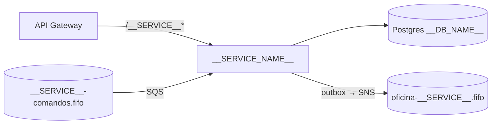

# **REPO**

[](https://github.com/guilhermeqmaia/__REPO__/actions/workflows/ci.yml) [](https://github.com/guilhermeqmaia/__REPO__/actions/workflows/cd-aws.yml)

****DESCRICAO**** — microsserviço do Sistema da Oficina Mecânica (Tech Challenge FIAP, Fase 4). Gerado pelo template do [`@guilhermeqmaia/oficina-kit`](https://github.com/guilhermeqmaia/soat-fiap-oficina-kit).

> Planejamento, RFCs/ADRs, contratos de eventos (AsyncAPI) e diagramas: [hub](https://github.com/guilhermeqmaia/soat-fiap-oficina-os-service/blob/main/docs/plano-execucao-fase-4.md).

## Responsabilidades

<!-- bounded contexts que este serviço POSSUI e o que ele NÃO possui -->

## Eventos e comandos

<!-- publica / consome — ver docs/contratos/asyncapi.yaml no hub -->

## Execução local

```bash
cp .env.example .env
npm ci && npx prisma generate
npm run docker:up                 # Postgres próprio + LocalStack com a topologia da RFC-0006
npx prisma migrate deploy
npm run start:dev                 # http://localhost:__PORT__/api (Swagger)
```

Token para testar: a Lambda de auth (`POST {gateway}/auth`) ou, localmente, `mintToken` do kit (`@guilhermeqmaia/oficina-kit/testing`) com o mesmo `JWT_SECRET`.

## Testes e qualidade

```bash
npm run test:unit:cov        # gate 80% (jest.unit.config.js)
npm run test:integration     # e2e com Postgres via testcontainers
```

<!-- Evidências de cobertura: badge do SonarCloud + print em docs/evidencias/ -->

## Deploy

CD automático (`cd-aws.yml`): `homolog` → homologação, `main` → produção. Build → ECR → EKS (`k8s-aws/`) → migrations → smoke.

| Secret/var do repo                      | Uso                                                        |
| --------------------------------------- | ---------------------------------------------------------- |
| `AWS_ROLE_ARN` (secret)                 | OIDC da role `github-actions-oficina`                      |
| `EKS_CLUSTER_NAME`, `AWS_REGION` (vars) | cluster alvo                                               |
| `DB_SECRET_ID` (var)                    | segredo do banco **próprio** no Secrets Manager (infra-db) |
| `JWT_SECRET_ID` (var)                   | segredo HS256 compartilhado com a Lambda                   |
| `SNS_TOPIC_ARN`, `SQS_QUEUE_URL` (vars) | saídas do stage `messaging/` (infra-k8s)                   |

O Service expõe o **NodePort `__NODE_PORT__`**, alvo do target group deste serviço no NLB interno único (ADR-0013).

## Arquitetura do serviço


